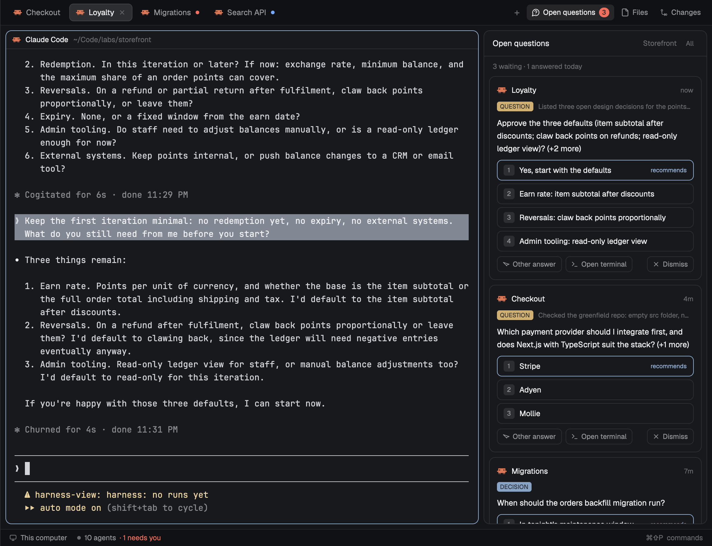

# Herdr Asks



Every decision your agents are waiting on, in one hideable panel per space. When an agent
stops to ask a question or request approval, Asks shows it as a card with the agent's own
options. You answer on the card and Asks presses the keys in that agent's terminal. Each
answer is appended to `docs/decisions.md` in the agent's workspace so the next agent can read it.

**Status:** v0.1, Herdr desktop app only. The TUI plugin is planned (see `docs/PRD.md`).

## What you get

- An **Open questions** button in the tab bar beside Files and Changes, with a count of asks waiting in
  the shown space (and `+N` when other spaces have some).
- The **Asks panel** on the right, same width rules as Files, hidden until you open it.
  Click the button or press `cmd-shift-a`. One panel per space; `All` shows every space.
- **Cards** with the agent, the kind (`APPROVAL`, `DECISION`, `QUESTION`, `UNCLEAR`), the
  question, the options verbatim with the agent's recommendation marked, an `Other answer`
  box, `Open terminal` and `Dismiss`.
- An **Answered** list under the cards, and a line per answer in `docs/decisions.md`.

## How it works

Herdr already knows when an agent is blocked. Claude Code goes further and reports what it
is asking in its status (`kind: question` with the options, or `kind: permission` with the
tool and target). Asks reads that report, then reads the screen for the option numbers and
the line of context. No model is involved for Claude Code.

**Finished turns count too.** When an agent ends a turn with plain-text questions instead
of a dialog, Asks reads that last message and asks `claude -p` (Haiku) whether the agent is
actually waiting on you. If so it becomes a `QUESTION` card; clicking an option or typing an
answer sends it to the agent as a message. Rhetorical "let me know if…" endings are skipped.

For agents that only report "blocked", Asks parses the numbered options on screen. If that
fails it asks `claude -p` (Haiku, structured output) to classify the dialog, and only trusts
the answer when every option it returns appears verbatim on screen. Otherwise the card is
`UNCLEAR` and offers only `Open terminal`.

Answers go through `hc`: the option's number key, then Enter if the dialog is still there.
Typed answers use `hc send --force` into the dialog. Before anything is sent, Asks checks
the agent still sits at the same dialog; if you answered it in the terminal meanwhile, the
card closes as "Resolved in terminal".

Nothing is ever answered without you clicking it.

## Install

Needs the Herdr desktop app (0.1.13 or later) and Node 18+.

```sh
git clone https://github.com/sachin-philip/herdr-openqn
node herdr-openqn/herdr-app/install.mjs
```

The installer copies two mods into `~/.config/herdr-app/mods/`, clones your shown layout
as `asks` with the panel and button added, binds `cmd-shift-a` under `layout:asks`, runs
`herdr-app check` on both mods and switches to the new layout. `cmd-shift-l` switches back;
`node herdr-app/install.mjs --uninstall` removes everything.

Or ask an agent in a Herdr terminal:

```
Add the Herdr mod from https://github.com/sachin-philip/herdr-openqn, folder herdr-app.
Follow its RECIPE.md.
```

Tell the person before installing: the mods run `hc` (to read screens and press keys) and
`claude -p` (Haiku) on each finished turn that contains a question mark, and on dialogs
Asks cannot parse. That sends the agent's last message to Anthropic through the person's
own Claude Code login, a few seconds and well under a cent per call. `trailing_questions:
false` keeps it to dialogs only; `classify: "off"` never calls a model.

## Configure

`~/.config/herdr-app/asks.json`, all optional:

```json
{
  "label": "Open questions",
  "log": "docs/decisions.md",
  "classify": "auto",
  "model": "haiku",
  "trailing_questions": true,
  "toast": false,
  "debug": false
}
```

- `label`: the words on the tab-bar button and the panel header.
- `log`: where answers are appended, relative to the agent's folder (`""` disables).
- `classify`: `auto` (model only when the report and screen say nothing usable), `always`
  (also adds a context line for parsed asks), `off` (never call a model).
- `trailing_questions`: check every finished turn for a plain-text question (needs the model).
- `debug`: append one line per detection step to `~/.config/herdr-app/asks.log`.
- `toast`: Herdr already toasts "needs you" for a blocked agent; `true` adds a second toast
  with the question.

Keys: `tabs-asks.toggle` shows or hides the panel, `tabs-asks.open` opens it,
`asks.accept` answers the newest waiting ask in the shown space with the recommended option
(not bound by default).

## Develop

```sh
herdr-app check herdr-app/mods/asks
herdr-app check herdr-app/mods/tabs-asks
cp -R herdr-app/mods/asks/. ~/.config/herdr-app/mods/asks/      # the app reloads on save
```

`mods/asks/state.js` and `mods/tabs-asks/state.js` must stay identical; mods import only
their own folder. Detection lives in `tabs-asks` because the tab bar is always shown, so
asks are found before the panel is ever opened.

## License

MIT.
